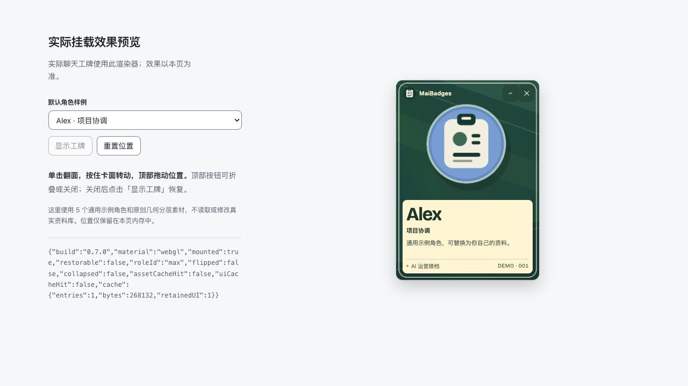

# MaiBadges


给 AI 同事一张可编辑、可交互的工牌。A local-first badge manager for your AI teammates.

**0.8.0 · 实验性社区项目 · macOS**

新增角色、编辑职责、上传头像、绑定聊天；工牌支持拖动、翻面、折叠、关闭后恢复，以及有上限的会话图片缓存。0.8.0 补入左侧员工卡片：在可识别的导航列表中，为用户已确认绑定且没有歧义的聊天行显示角色身份，保留原有点击与定时任务图标。管理页跟随宿主明暗主题。公开版只包含原创几何示例，不包含个人品牌、真实团队角色、私有签名字体或聊天资料。

**从 0.7.0 升级：**0.7.0 只有右侧浮动工牌，没有左侧员工卡片。请一并更新完整源码或安装包，按 [升级说明](UPGRADE.md) 运行 `prepare`、通过宿主正常功能更新 `work-badges`，再重新启动加载器。单独运行 `install-launcher` 不会更新工牌界面。保留原来的 state 目录即可继续使用已保存的角色、头像和绑定。



仓库：[yezhonghu0503/MaiBadges](https://github.com/yezhonghu0503/MaiBadges)。本地验收范围见 [发布检查](docs/RELEASE_CHECK.md)。

## 两部分，可分别使用

| 部分 | 用途 | 权限与边界 |
| --- | --- | --- |
| 本地 MCP 管理插件 | 新增、编辑、复制、停用工牌；保存用户确认的聊天绑定 | 本地 stdio 服务和隔离管理页；不连接桌面调试端口 |
| 可选桌面加载器 | 在聊天主窗口显示右侧浮动工牌，并为可识别的已绑定导航行显示左侧员工卡片 | 用户显式登记主窗口、启动后，通过回环 CDP 挂载；不是官方侧栏 API |

可以只安装管理插件。右侧浮动工牌与左侧员工卡片都需要另行启用加载器；仅在管理页保存绑定不会启动加载器。未绑定、停用、标题有歧义或无法安全识别的导航行保持宿主原样。

## 安装与使用

需要 Python 3.9+。开发和离线测试另需 Node.js 20+。无需 API Key 或 Python 第三方运行库。

在克隆后的仓库根目录打开终端：

```sh
MAIBADGES_PACKAGE="$PWD"
MAIBADGES_PROJECT="$MAIBADGES_PACKAGE"
MAIBADGES_STATE="$HOME/Library/Application Support/MaiBadges"
python3 "$MAIBADGES_PACKAGE/setup.py" prepare \
  --project-dir "$MAIBADGES_PROJECT" --state-dir "$MAIBADGES_STATE"
```

按 [完整安装流程](INSTALL.md) 将 `work-badges` 从输出的本地来源安装到支持本地插件的宿主，再请求调用 `work_badges_open`。首次设置与可选加载器步骤均在安装文档中；`prepare` 不启动宿主、加载器或登录自启。

默认本地来源名是 `maibadges-local`，插件 slug 和工具名仍为 `work-badges`、`work_badges_open`。宿主的插件界面及支持范围可能随版本变化。

## 数据与兼容性

角色、头像、绑定及位置存放在本机 SQLite 与素材目录。项目没有自建云服务、遥测或支付功能；但 MCP 宿主可能把工具返回的结构化角色资料加入聊天，适用宿主自己的数据政策。详见 [PRIVACY.md](PRIVACY.md)。

加载器读取目标窗口元数据、完整标题，以及导航行的标题与标识来匹配用户保存的绑定，不采集聊天消息正文。同名聊天不能区分，聊天改名后需要重新绑定。侧边栏只处理可识别且无歧义的已绑定行，保留其导航点击和定时任务标识。

0.8.0 减少未变化资料的重复传输与渲染，复用有上限的会话缓存。侧边栏缓存导航节点、合并扫描，忽略对话正文和输入区变化；指针视差按需更新，隐藏、减少动态效果或卸载时停止相关动画帧。首次显示仍需解码图片；这些优化不保证零延迟，也没有统一的耗时或内存降幅承诺。

桌面集成目前只面向 macOS；浏览器预览和离线测试不能证明所有桌面客户端兼容。浮动加载器依赖宿主暴露的 Chromium 调试能力与页面结构，宿主更新后可能失效。它不修改或分发官方应用安装包，不绕过宿主拒绝或安全策略。本项目不隶属于 OpenAI，也未获得其背书；使用者需自行评估宿主条款和调试权限。

## 开发

```sh
python3 build_package.py
python3 validate.py
python3 build_package.py --archive
```

构建生成管理页、共享工牌渲染器和只读示例预览。`validate.py` 运行本地合同与打包检查；具体结果以该次命令输出为准。预览启动方法见 [docs/PREVIEW_GUIDE.md](docs/PREVIEW_GUIDE.md)。

## 许可证与致谢

项目代码和原创几何示例采用 [MIT](LICENSE)。字体保留 OFL；Holo Card 改编代码保留原 MIT 版权声明。详见 [第三方声明](THIRD_PARTY_NOTICES.md)、[素材许可](ASSETS_LICENSE.md) 与 [来源说明](docs/HOLO_UPSTREAM.md)。创意启发致谢 **@乌托邦的香蕉**；不包含上游示例卡片、默认卡背或角色作品。

问题反馈和贡献请先看 [CONTRIBUTING.md](CONTRIBUTING.md)；敏感漏洞请看 [SECURITY.md](SECURITY.md)。
